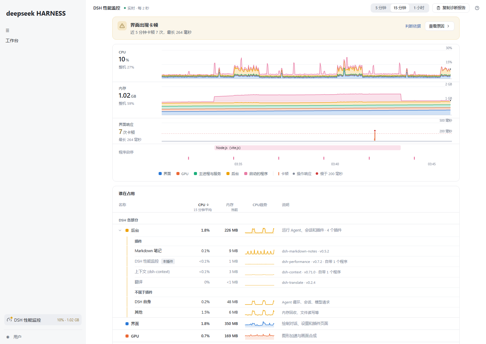
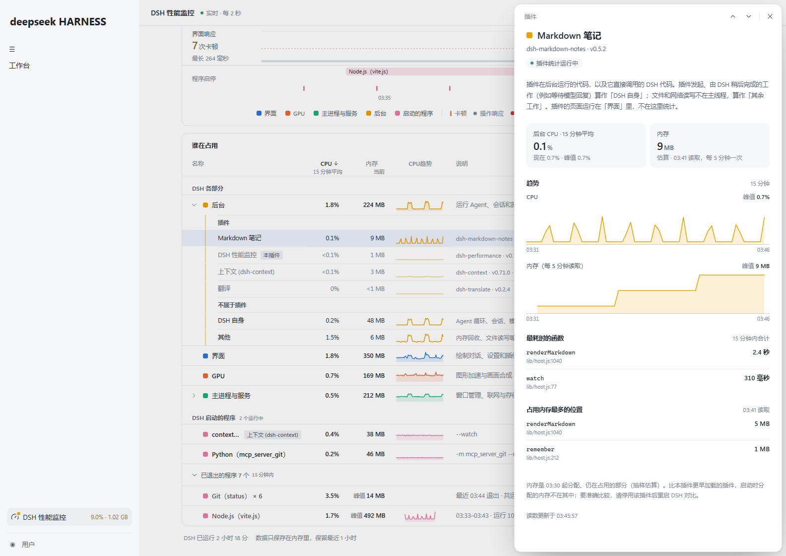
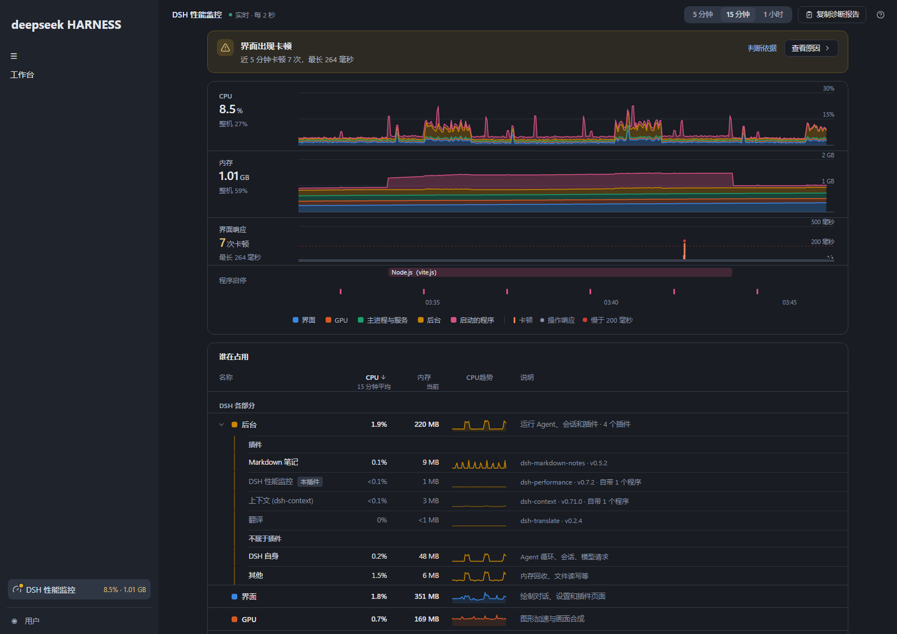

# DSH 性能监控

小而美？看清 DSH 的 CPU、内存与卡顿：按插件、终端、MCP 拆分占用，对照卡顿时刻，复制诊断报告。仅限 Windows x64。

用来回答五个问题：

- 电脑慢，是不是 DSH 造成的？
- DSH 的哪一部分、它启动的哪个程序在占用资源？
- 刚才卡的那一下是什么时候、和什么同时发生的？
- 长时间运行后，内存有没有一直上涨？
- 哪个插件在占用 DSH 后台的 CPU 和内存？

## 界面预览

以下截图来自加载实际构建产物的隔离浏览器环境，资源读数为模拟场景。市场预览图由 [screenshots.json](screenshots.json) 声明。



<details>
<summary>后台插件详情与深色主题</summary>





</details>

## 安装

通过 `engines.dsh` 声明兼容 DSH 0.2 系列（`^0.2.0-rc.2`），在 `0.2.0-rc.2` 上实测过。采集器为 Windows x64 程序，使用系统自带的 .NET Framework 4.x。

从 [Releases](https://github.com/Wanyi424/dsh-performance/releases/latest) 下载预构建的 `.tgz` 安装包，无需解压。在 DSH 左侧「插件」→「添加插件」中选择下载的文件，例如：

```text
D:\Downloads\dsh-performance-0.7.3.tgz
```

启用后完整退出并重启 DSH。不需要 API Key，不调用模型，也不与 Agent 交互。

Release 同时提供固定文件名 `dsh-performance.tgz`，供插件市场下载当前版本；它与带版本号的安装包内容相同。

## 使用

**侧栏入口**：侧栏底部的「DSH 性能监控」一行，右侧实时显示 CPU 和内存合计。需要留意时图标上亮一个圆点、数字变色，悬停可看原因。点击打开详情页；侧栏收起时只留图标。

**详情页**是一栏，从上到下回答三个问题。顶栏可以切换时间范围（5 分钟、15 分钟、1 小时）、复制诊断报告、打开「这些数字怎么来的」。

1. **有没有问题**：顶部的结论。
   - 正常时只有一行「DSH 运行正常」。
   - 有需要留意或值得一提的情况时变成一张卡片，点名原因；「查看原因」直接打开对应的详情，「判断依据」打开规则。
2. **什么时候、和什么同时发生**：趋势。CPU、内存、界面响应三条轨道共用一条时间轴，最下方是程序启停。
   - 每条轨道左侧是当前值和一行参照：CPU 和内存是整机的占用，界面响应是最长的一次卡顿。峰值和变化量直接看图。
   - 悬停时一根竖线贯穿三条轨道，提示框列出那一刻各部分的 CPU 和内存、DSH 合计和整机；「后台」下面列出那一刻最忙的插件或部分。悬停期间时间轴不滚动，方向键可以逐点查看。
   - 图例和程序启停条都可以点，打开对应的详情。
3. **是谁**：「谁在占用」一张表，名称、CPU、内存、趋势、说明各占一列。CPU 为所选时间内的平均值，内存为当前值。
   - **DSH 各部分**：界面、GPU、主进程与服务、后台。后台默认展开，分成「插件」和「不属于插件」（「DSH 自身」和「其他」）两组，CPU 几行相加等于后台；插件的说明写包名和版本，几乎不占用的行整行变浅。
   - **DSH 启动的程序**：终端、Agent 执行的命令、MCP 服务等，子进程合并计算；插件自带的程序标出所属插件。已退出的程序收在底部，同一命令的多次运行合并为一行。
   - 指向一行，趋势图里只突出它所在的部分；鼠标停在表上时行序保持不动。

**详情抽屉**：点任何一行、图例或程序条，详情从右侧浮出，背后的页面原样不动。
- **内容顺序固定**：是什么、CPU 与内存、趋势、构成（包含的进程、后台按插件拆分、最耗时的函数和占内存的位置）、技术信息（PID、启动时间、程序位置、可复制的命令行）。
- **切换**：右上角的上下箭头（或 K / J）按列表顺序切到上一项、下一项。
- **下一层**：在详情里打开另一项（例如从「后台」点进某个插件），左上角出现返回。
- **关闭**：Esc 或点抽屉外，焦点回到原来那一行。

**复制诊断报告**：把结论、各部分、插件和程序的占用、界面响应整理成 Markdown，可以直接贴进问题反馈。只列程序名，不含命令行和文件路径。

窗口不可见时自动暂停采集。采集失败时，页面保留最后一次读数并变淡，顶部显示原因和「重试」，15 秒后也会自动重试。

## 统计口径

从插件所在的后台进程向上，找到最上层的 `DeepSeek Harness.exe`，即桌面主进程。再沿进程树向下，统计：

1. 桌面主进程，以及它的界面渲染、GPU、网络、存储等子进程。进程类型由 Electron 的 `--type` 参数识别。
2. DSH 后台服务，即同一个可执行文件以 Node 模式运行的进程。
3. 后台启动的全部程序及其子孙进程，即「工具进程」，计入合计。

以下不计入：
- 采集器自身的占用，显示在「插件」分区「DSH 性能监控」一行的自带进程中，不计入 DSH 合计。
- 父进程已经退出的程序，因为无法确认来源。
- 树外的同名程序。

插件不接受网页传入的 PID 或命令，也不提供结束进程的操作。

指标定义：
- **CPU**：各进程在采样间隔内使用的 CPU 时间之和，除以间隔和逻辑处理器数。100% 表示整台电脑的算力全部占满，与任务管理器一致。两次采样之间启动的进程，其全部 CPU 时间都计入这个间隔；PID 被复用时不沿用旧进程的读数。
- **内存**：进程专用工作集之和，与任务管理器「详细信息」页的「内存(专用工作集)」列一致。需要 Windows 10/11 22H2 及 2023 年 9 月以后的累积更新，不支持时显示 `—`。个别进程没有读取权限时不计入合计，并在「此刻」中注明数量。
- **整机**：CPU 来自 `GetSystemTimes`，与 DSH 用同一个采样间隔计算；内存为已使用的物理内存，即总量减去可用（`GlobalMemoryStatusEx`）。
- **界面响应**：
  - **卡顿**：取自 Chromium 的 Long Animation Frames，即一帧被拖延超过 50 毫秒；不支持时退回 Long Tasks。
  - **交互延迟**：取自 Event Timing，即从点击或按键到界面画出反馈的时间，超过 200 毫秒标红。
  - 两者都由浏览器事件推送，没有轮询，只在窗口可见时记录。打开本页期间，本页自身的绘制也会计入。
- **插件占用**：插件没有自己的进程，全部运行在 DSH 后台进程里（界面部分在界面渲染进程里），系统无法分开计量。后台从启动起通过 `node:inspector` 持续使用 V8 的 CPU 采样分析器和抽样堆分析器，打不打开详情页都在统计。可以在「后台」的详情里暂停，直到继续或 DSH 重启。
  - **CPU**：窗口可见、读数持续时，每 10 毫秒记录一次主线程的调用栈。每次读数结束上一段、开始下一段（两段重叠交接，分析器不重启），所以插件占比与 CPU 读数是同一个时间段，换算成整机占比。
  - **归属**：每个样本归到调用栈上离它最近的插件代码。插件按其安装目录（`~/.dsh/profiles/desktop/node_modules/<插件>`）识别；DSH 安装目录中的代码算作 DSH 内核，并按包细分。插件同步调用的 DSH 代码算作该插件；插件触发后由 DSH 稍后异步完成的工作（比如等待中的模型请求）不带插件的调用栈，算作 DSH 内核。
  - **范围**：只统计后台主线程。文件和网络读写在线程池里，不计入；界面部分不在范围内，因为插件的界面由 DSH 共用的 React 渲染，无法可靠归属。
  - **内存**：从后台启动采样起，每分配约 128 KB 抽样记录一次分配位置。采样启动约 1 分钟后第一次读取，之后窗口可见时每 5 分钟一次，得到各插件分配、目前仍占用的内存（抽样估算）。读取前 V8 会做一次完整的垃圾回收，后台会短暂停顿；暂停后释放采样器和归属缓存，暂停期间的分配不计入。
  - **调试会话的副作用**：会话连接期间，V8 会替调试器保留最近约 1000 次 `console` 调用的参数。后台每 30 秒、以及每次读取内存前清掉它们，所以它们既不常驻内存，也不会算进插件的内存。用 DevTools 调试后台时有两点副作用：JavaScript Profiler 面板里会看到本插件交接用的分段记录（标题以 `dsh-performance#` 开头）；控制台里超过 30 秒的旧输出，其中的对象可能无法再展开。
  - 插件列表来自 profile 的 `package.json` 中记录的组合包，去掉 `@deepseek-ai/` 下 DSH 自带的部分；插件名称取自插件的语言文件。
- **程序启停**：根据每次读数推断。启动时间取进程自己的创建时间；退出时间是最后一次看到它运行的时刻。窗口不可见期间启动又退出的程序不会出现。

## 开销控制

- **采样频率**：侧栏常驻读数时每 3 秒一次，打开详情页时每 2 秒一次，失败后每 15 秒一次。两处共用一个采样器。
- **Host 端合并**：并发请求合并为一次，1.8 秒内的重复请求直接复用结果。
- **采集器**：每次请求只读一次进程快照，以及树内各进程的 CPU 时间、内存、线程数和两项整机计数。命令行每个进程只读一次并缓存。不使用 WMI、PowerShell，不扫描文件；闲置 15 秒后退出。
- **历史数据**：只保存在内存中，保留 1 小时，不写磁盘、不上传。
  - 趋势每个读数只存五个分组的汇总。
  - 每个进程和程序的趋势按 15 秒汇总。
  - 已退出的程序最多保留 300 个。
  - 卡顿和交互各最多 3000 条。
- **插件归属**：以下是 2026-10-17 用 DSH 自带运行时（Electron 44）、约 150 MB 的堆，在本机 16 个逻辑处理器上的探测结果。该采样从后台启动起常驻运行。
  - **常驻采样开销**：每 10 毫秒采样，空闲时的 CPU 开销低于 Windows 能计量的精度。按每 1 毫秒采样的单核 2.3% 推算，约为整机的 0.02%。
  - **启动停顿**：启动分析器要扫描一遍后台的内存，后台约停顿 0.3 秒，随堆大小增长。所以它只在后台启动时启动一次，之后一直运行；暂停后再继续会重新停顿一次。实际停顿时长显示在「这些数字怎么来的」中。
  - **分段交接**：每段约 0.3 毫秒。
  - **读取内存**：一次完整的垃圾回收，150 MB 的堆约 0.1 秒，每 5 分钟最多一次，只在窗口可见时进行。
  - **数据保留**：原始样本只在后台用于汇总，每段归属后即丢弃；保留的是一小时内按分钟汇总的函数耗时，每个插件每分钟最多 20 项。不传原始数据给页面，不写磁盘。
- **页面渲染**：
  - 长时间范围按绘图宽度抽稀，每两个像素约画一个点；统计仍使用全部读数。实测一小时、1800 个读数的统计每次约 0.1–0.2 ms。
  - 页面没有循环播放的动画，只在数据更新或用户操作时短暂动一下。
- **包体**：侧栏入口约 14 KB，常驻加载；详情页约 89 KB，打开时才加载；后台部分约 22 KB。复用 DSH 的 React，不引入图表库、组件库或图标库。

0.2.0 曾在本机测得：采集器稳定后约占整机 0.06% CPU，专用工作集约 10 MB；0.3.0 与 0.4.0 的采集器检查中约 5 MB。插件归属在真实 DSH 后台中的停顿以「统计口径」里显示的为准；采集器部分可用下文的基准脚本复测。

## 开发与验证

```powershell
npm ci
npm run typecheck
npm test
npm run build
npm run check:collector
npm run check:browser
npm pack --pack-destination dist
```

- `npm run build`：用系统自带的 .NET Framework C# 编译器生成 `lib/collector.exe`，发布包同时包含 `native/Collector.cs` 源码。
- `npm test`：单元测试。其中两项在 Node 进程内真实运行 V8 的 CPU 与堆分析器，验证以下几点：
  - 分段交接后，一个模拟插件的忙循环被归到该插件，并给出函数与行号；
  - 它保留的内存被计入，而只是打印过的对象不计入；
  - 没有读数时仍按时间窗口分段记录；手动暂停后释放分析器，继续时重新启动。
- `check:collector`：用一棵隔离的 Windows 进程树验证采集结果，包括：
  - 进程类型识别：主进程、界面渲染、GPU、Host，Host 启动的 Shell 及其子进程；
  - 树外同名程序被排除；
  - 整机计数与线程数的读取；
  - 可执行文件位于插件目录中的工具进程归属到该插件；
  - 每次读数带上后台主线程按插件的拆分；
  - 并发合并、闲置退出、重建基线与释放。
- `check:browser`：在隔离载体中加载实际构建的界面。请求由 Playwright 拦截应答，不占用端口。
  - 数据：采集读数为脚本化场景，卡顿和慢交互是 Chromium 真实产生的事件。
  - 验证范围：懒加载、选中态、整机占比、三轨联动与提示框（含后台主线程的拆分）、程序启停、联动高亮、已退出程序、侧边详情、排序、插件分区与插件详情（拆分数据为脚本化场景）、插件自带进程、可见性暂停、错误与重试、窄屏和深色主题。
  - 截图保存在 `artifacts/`；需要 Playwright Chromium。

可选：对正在运行的 DSH 做只读实测。参数换成桌面主进程的 PID，即任务管理器「详细信息」页中最上层的 `DeepSeek Harness.exe`：

```powershell
node --import tsx scripts/benchmark.ts <DSH桌面主进程PID>
```

## 文件结构

```text
native/Collector.cs    Windows 只读采集器：沿进程树读取 CPU 时间、内存、线程、进程类型、可执行文件路径和整机计数
src/collector.ts       采集器生命周期、请求合并与缓存
src/plugins.ts         从 profile 读取已安装插件及其目录
src/profiler.ts        后台常驻的 V8 CPU 与堆采样，随读数分段交接，按时读取内存，可暂停
src/attribution.ts     把采样结果按调用栈归到插件、DSH 模块、垃圾回收
src/metrics.ts         进程分类、CPU 与整机占用计算
src/insights.ts        历史点、抽稀、区间统计、后台按插件拆分、程序合并与命名
src/tracking.ts        每个部分、进程、程序和插件的 15 秒趋势，以及程序启停记录
src/responsiveness.ts  卡顿帧与交互延迟记录
src/verdict.ts         结论规则：什么情况下提示，点名谁
src/breakdown.ts       「谁在占用」的行：各部分、插件、程序与已退出的程序
src/report.ts          诊断报告（Markdown）
src/controller.ts      共享采样器与可见性管理
src/api.ts             页面到后台路由的请求
src/host.ts            DSH Host API
src/client.tsx         侧栏入口与详情页懒加载
src/page.tsx           详情页：结论、趋势、谁在占用和抽屉的组织
src/conclusion.tsx     顶部结论
src/timeline.tsx       三轨联动趋势与程序启停
src/usage.tsx          「谁在占用」表格
src/drawer.tsx         详情抽屉：切换、下一层与返回
src/details.tsx        抽屉的共用部件，以及各部分、进程和程序的详情
src/owner.tsx          后台、插件与 DSH 自身的详情：按插件拆分、函数与内存位置
src/about.tsx          这些数字怎么来的
src/spark.tsx          趋势小图
tests/                 单元测试与隔离载体
scripts/               构建、原生验证、浏览器验证与基准
```

MIT License。运行时复用 DSH 提供的 React；采集器只调用 Windows API 和系统 .NET Framework。
